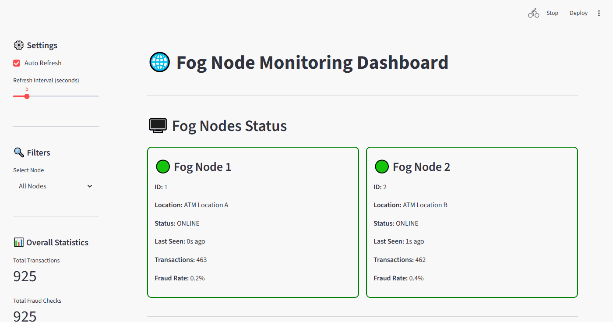
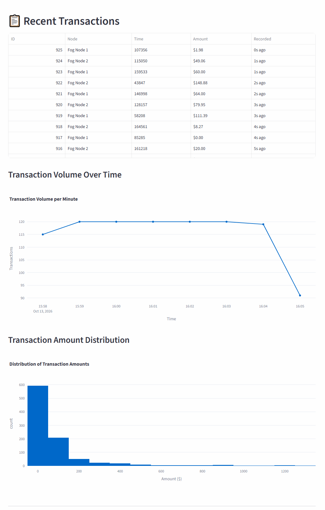
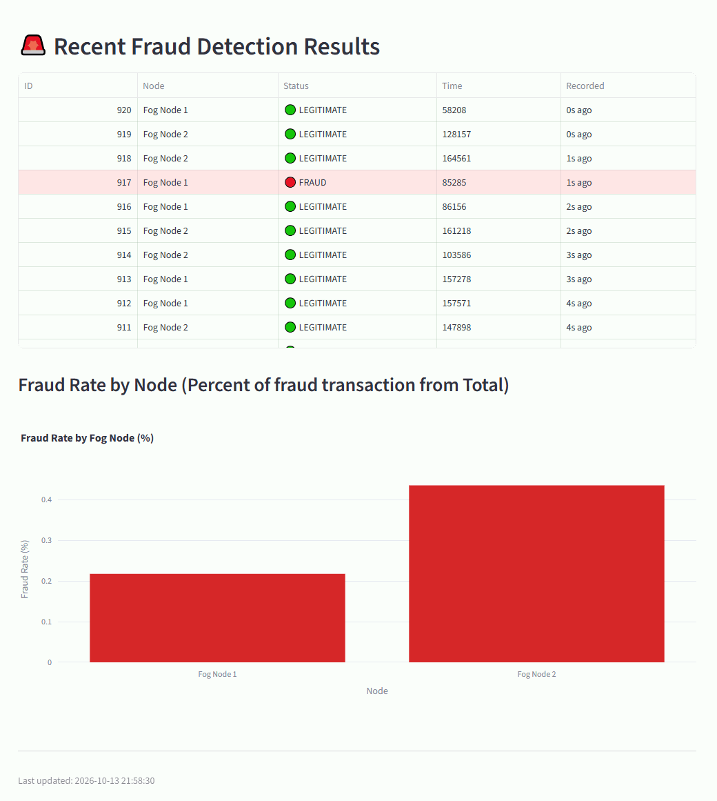

# Fog ATM Fraud Detection System

*Built for a fog and cloud computing course (2025).*

A distributed real-time credit card fraud detection system built on fog computing. The fraud detection model is designed to run on the ATM itself: each ATM is a fog node that scores every transaction locally, where the card is used, and sends an email alert when it detects fraud. All ATMs report their transactions and predictions over MQTT to one central server, which stores them and shows every ATM on a single Streamlit monitoring dashboard. In this demo, two simulated ATMs replay transactions from the Kaggle dataset.



## Project Overview

This project implements a complete end-to-end fraud detection pipeline with fog computing:

1. **Data Preparation** - Download and process Kaggle credit card fraud dataset
2. **Model Training** - Train and evaluate multiple ML models, select best performer
3. **Model Distribution** - The central server sends the trained model to every ATM (fog node) via FTP
4. **Edge Processing** - Each ATM runs the model itself and scores every transaction locally
5. **Real-time Monitoring** - One centralized dashboard tracks the transactions and fraud predictions of all ATMs
6. **Alert System** - The ATM sends an email notification when it detects fraud

## System Architecture

```
┌─────────────────────────────────────────────────────────────────┐
│                         CENTRAL SERVER                          │
│  ┌──────────────┐  ┌──────────────┐  ┌──────────────────────┐   │
│  │  FTP Server  │  │ MQTT Broker  │  │  MQTT Subscriber     │   │
│  │  (Port 21)   │  │  (Port 1883) │  │  (Stores to DB)      │   │
│  └──────────────┘  └──────────────┘  └──────────────────────┘   │
│         │                  ▲                      │             │
│         │                  │                      ▼             │
│    ┌────────┐         ┌────────┐         ┌──────────────┐       │
│    │ Models │         │ Topics │         │   SQLite DB  │       │
│    │  Data  │         │        │         │              │       │
│    └────────┘         └────────┘         └──────────────┘       │
│                                                    │            │
│                                           ┌──────────────────┐  │
│                                           │  Dashboard       │  │
│                                           │  (Streamlit)     │  │
│                                           └──────────────────┘  │
└─────────────────────────────────────────────────────────────────┘
                              ▲
                              │ MQTT Messages
                              │
        ┌─────────────────────┴─────────────────────┐
        │                                           │
┌───────▼──────────┐                     ┌──────────▼─────────┐
│ ATM 1 (fog node) │                     │  ATM 2 (fog node)  │
│  ┌────────────┐  │                     │  ┌────────────┐    │
│  │ Fog Node 1 │  │                     │  │ Fog Node 2 │    │
│  │            │  │  ...                │  │            │    │
│  │ + ML Model │  │                     │  │ + ML Model │    │
│  │ + Data     │  │                     │  │ + Data     │    │
│  └────────────┘  │                     │  └────────────┘    │
└──────────────────┘                     └────────────────────┘
```

## Project Structure

```
fog-atm-fraud-detection/
├── README.md                     # This file - Project overview
├── docker-compose.yml            # One-command demo (see Quick Start)
├── docker/                       # Mosquitto and server config used by Docker
├── docs/                         # Manual setup, MQTT, configuration, troubleshooting
│   └── images/                  # Dashboard screenshots
├── client/                       # FOG NODE (Edge devices)
│   ├── README.md                # Client-specific setup instructions
│   ├── .env_exemple             # Email configuration template
│   ├── requirements.txt         # Client dependencies
│   ├── src/
│   │   ├── fog_node.py         # Main fog node application
│   │   └── download_models.py  # Download models and data from FTP server
│   ├── scripts/
│   │   └── send_test_email.py  # Send a test email alert
│   ├── models/                  # Downloaded ML models (via FTP)
│   └── data/                    # Downloaded simulation data (via FTP)
│
└── server/                       # CENTRAL SERVER
    ├── README.md                # Server-specific documentation
    ├── config.yaml              # Server configuration
    ├── config_example.yaml      # Configuration template
    ├── requirements.txt         # Server dependencies
    ├── requirements-notebook.txt # Extra dependencies for the notebook
    ├── src/
    │   ├── train.py            # Script version of the training pipeline
    │   ├── ftp_server.py       # FTP server for model distribution
    │   ├── mqtt_subscriber.py  # MQTT client receiving fog node data
    │   ├── dashboard.py        # Streamlit monitoring dashboard
    │   └── database.py         # SQLite database handler
    ├── notebooks/
    │   └── credit_card_fraud_detection_complete.ipynb
    ├── data/                    # Dataset and splits
    ├── models/                  # Trained models
    └── ftp_root/                # FTP server root directory
```

---

## Quick Start Guide

### Run the demo with Docker

With [Docker](https://docs.docker.com/get-docker/) installed, one command starts the whole system
(MQTT broker, FTP server, MQTT subscriber, dashboard and two fog nodes):

```bash
docker compose up --build
```

Then open the dashboard at **http://localhost:8501**.

- On the first run, the `train` service downloads the Kaggle dataset and trains the
  Random Forest (`server/src/train.py`); this takes a few minutes. The model and simulation
  data are saved in `server/models/` and `server/data/` and reused on later runs.
- The fog nodes download the model from the FTP server, then publish one transaction per
  second each (about 34 minutes for the 2,020 rows of each node).
- Email alerts are disabled in Docker unless you add `SENDER_EMAIL`, `SENDER_PASSWORD` and
  `RECEIVER_EMAIL` to the fog node services in `docker-compose.yml`.
- Stop with `Ctrl+C`; `docker compose down -v` also deletes the dashboard database.

To set the system up by hand on separate machines instead, follow the [manual setup guide](docs/manual-setup.md).

---

## Dataset Information

**Source**: [Kaggle Credit Card Fraud Detection](https://www.kaggle.com/datasets/mlg-ulb/creditcardfraud)

**Details**:
- **Size**: 150MB
- **Records**: 284,807 transactions
- **Features**: 28 PCA-transformed features (V1-V28) + Time + Amount
- **Target**: Class (0 = Legitimate, 1 = Fraud)
- **Imbalance**: ~0.17% fraud cases

---

## Machine Learning Models

**Trained Models**:
- Logistic Regression
- **Random Forest Classifier** **(Selected)**
- XGBoost

**Evaluation Metrics**:
- Precision, Recall, F1-Score
- ROC-AUC
- Confusion Matrix
- Class imbalance handling (SMOTE/class weights)

**Model Files**:
- `models/best_model_random_forest.pkl` - Trained classifier
- `models/scaler.pkl` - StandardScaler for normalization

**Performance**: Optimized for high recall to minimize false negatives (missed frauds).

---

## Dashboard Features

Access at **http://localhost:8501**

| Recent transactions and charts | Fraud detection results |
| --- | --- |
|  |  |

**Real-time Monitoring**:
- 🟢 Online / 🟠 Warning / 🔴 Offline / ⚪ Unknown node status
- Last seen timestamps
- Auto-refresh (configurable interval)

**Visualizations**:
- **Recent Transactions** - Last 20 transactions table
- **Fraud Alerts** - Color-coded fraud detection results
- **Transaction Volume Over Time** - Hourly line chart
- **Amount Distribution** - Histogram
- **Fraud Rate by Node** - Bar chart comparison

**Filtering**:
- Filter by specific fog node
- View all nodes combined

---

## System Workflow

```
1. Fog Node downloads model & data via FTP
         ↓
2. Fog Node loads ML model locally
         ↓
3. Fog Node processes transactions (edge computing)
         ↓
4. Fog Node publishes raw data → MQTT → Server
         ↓
5. Fog Node publishes predictions → MQTT → Server
         ↓
6. MQTT Subscriber saves to SQLite database
         ↓
7. Dashboard visualizes real-time data
         ↓
8. Email alerts sent on fraud detection
```

---

## Documentation

- [Manual setup](docs/manual-setup.md) - install and run the server and fog nodes without Docker
- [MQTT communication](docs/mqtt.md) - topics and message formats
- [Configuration](docs/configuration.md) - settings and environment variables
- [Troubleshooting](docs/troubleshooting.md) - common server and client issues

---

## Additional Resources

- **Server Documentation**: See [`server/README.md`](server/README.md)
- **Client Documentation**: See [`client/README.md`](client/README.md)
- **Training Notebook**: `server/notebooks/credit_card_fraud_detection_complete.ipynb`
